# NexFinance User Manual Book
## Panduan Penggunaan Aplikasi untuk Pengguna Operasional

> **Versi Dokumen:** 1.0  
> **Aplikasi:** NexFinance (Al-Musabbihin)  
> **Domain Produksi:** `https://nexfinance.nexoratech.co`

Dokumen ini adalah panduan penggunaan harian (non-teknis) untuk seluruh modul NexFinance.  
Setiap modul dilengkapi **URL akses** dan **snapshot real** dari tampilan aplikasi.

---

## 1. Quick Access URL

| Modul | URL Produksi |
| --- | --- |
| Login | `https://nexfinance.nexoratech.co/login` |
| Dashboard | `https://nexfinance.nexoratech.co/dashboard` |
| SPP | `https://nexfinance.nexoratech.co/spp` |
| Penggajian | `https://nexfinance.nexoratech.co/payroll` |
| Pengeluaran | `https://nexfinance.nexoratech.co/expenses` |
| Pengadaan | `https://nexfinance.nexoratech.co/procurement` |
| Akuntansi | `https://nexfinance.nexoratech.co/accounting` |
| Laporan | `https://nexfinance.nexoratech.co/reports` |
| Master Siswa | `https://nexfinance.nexoratech.co/master/students` |
| Master Karyawan | `https://nexfinance.nexoratech.co/master/employees` |
| Master Hak Akses Role | `https://nexfinance.nexoratech.co/master/access` |
| Activity Logs | `https://nexfinance.nexoratech.co/activity-logs` |
| Notifikasi | `https://nexfinance.nexoratech.co/notifications` |

---

## 2. Login

**Tujuan:** Masuk ke sistem sesuai hak akses role pengguna.

**Langkah cepat:**
1. Buka URL login.
2. Isi email dan password.
3. Klik **Sign In**.

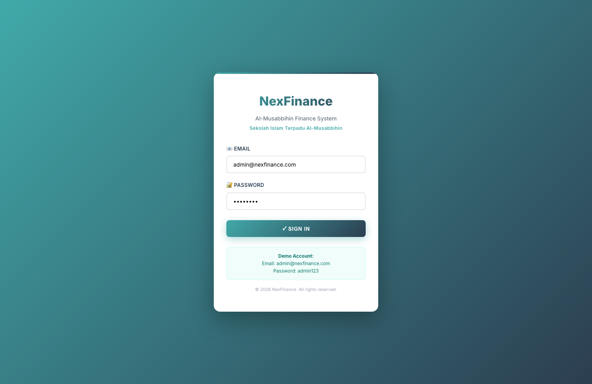

---

## 3. Dashboard

**URL:** `https://nexfinance.nexoratech.co/dashboard`  
**Fungsi utama:** Ringkasan KPI keuangan, tren bulanan, dan distribusi beban.

**Yang bisa dilakukan:**
1. Memantau KPI utama (pendapatan, collection rate, saldo, item aksi).
2. Klik card/KPI untuk menavigasi ke detail modul terkait.
3. Klik chart untuk melihat detail data ringkas.

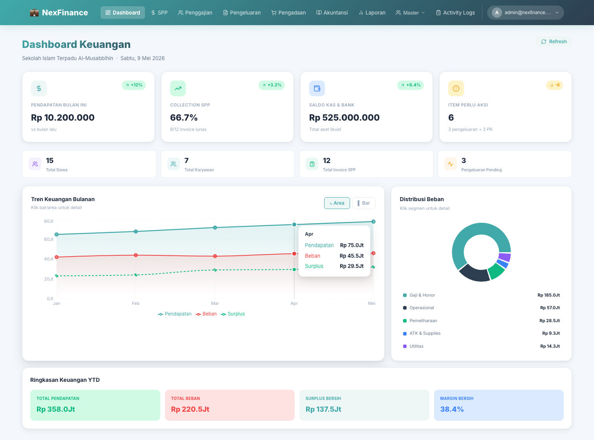

---

## 4. Modul SPP

**URL:** `https://nexfinance.nexoratech.co/spp`  
**Fungsi utama:** Kelola invoice SPP dan pembayaran siswa.

**Yang bisa dilakukan:**
1. Membuat invoice SPP.
2. Mencatat pembayaran.
3. Mencetak bukti pembayaran.

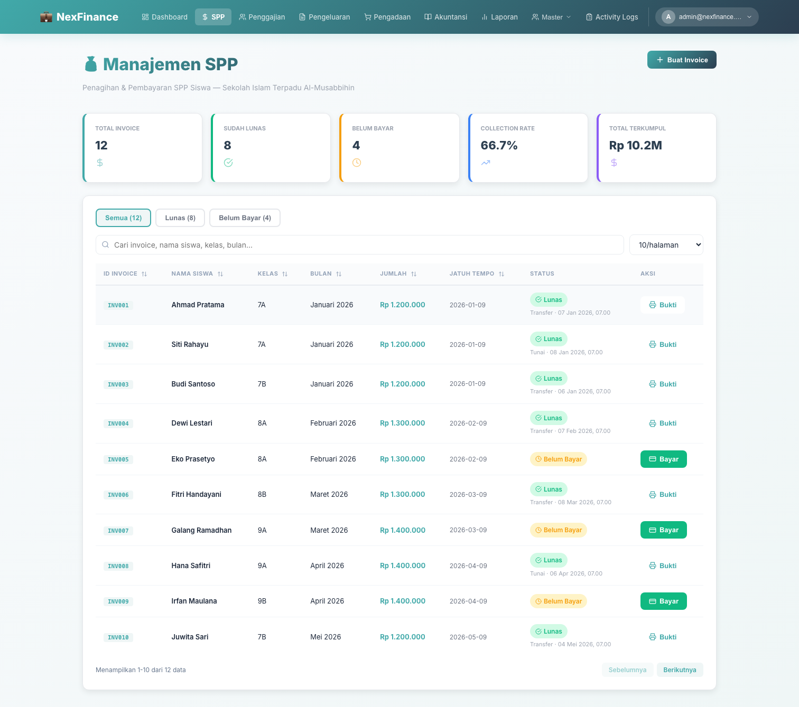

---

## 5. Modul Penggajian

**URL:** `https://nexfinance.nexoratech.co/payroll`  
**Fungsi utama:** Hitung payroll dan lihat histori penggajian.

**Yang bisa dilakukan:**
1. Memilih karyawan dan periode.
2. Menjalankan perhitungan gaji.
3. Meninjau histori payroll.

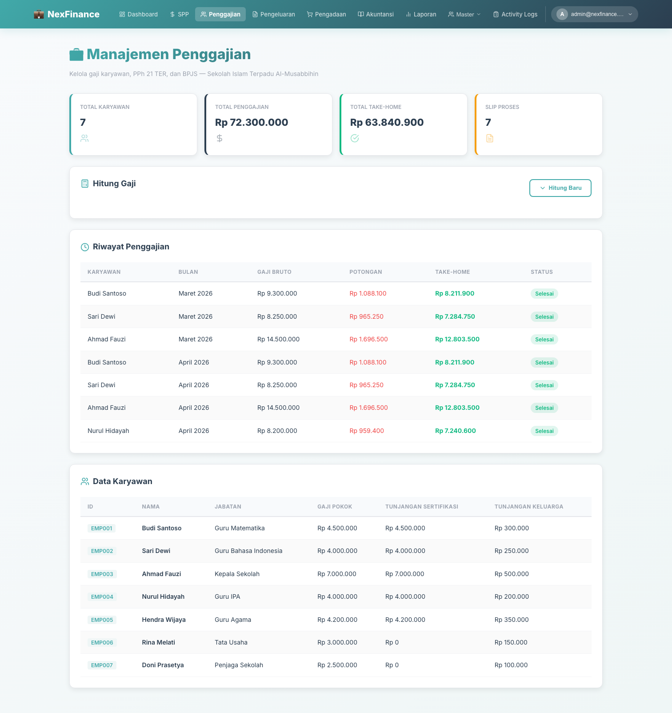

---

## 6. Modul Pengeluaran

**URL:** `https://nexfinance.nexoratech.co/expenses`  
**Fungsi utama:** Pengajuan dan approval biaya operasional.

**Yang bisa dilakukan:**
1. Membuat pengajuan pengeluaran.
2. Review status (pending/approved/rejected).
3. Approval/reject sesuai role.

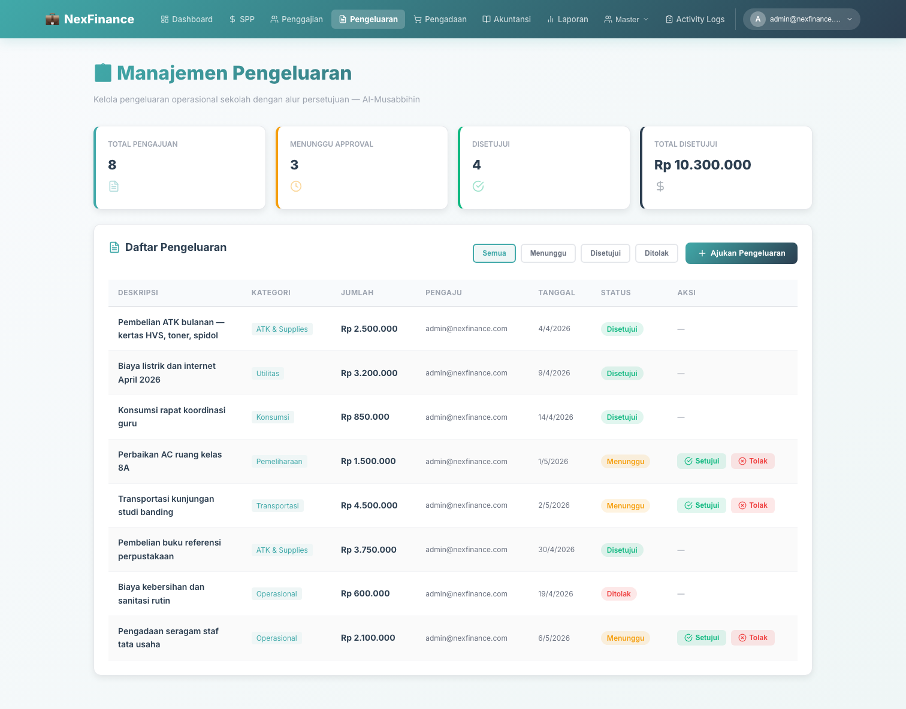

---

## 7. Modul Pengadaan

**URL:** `https://nexfinance.nexoratech.co/procurement`  
**Fungsi utama:** Kelola alur PR → PO → penerimaan.

**Yang bisa dilakukan:**
1. Membuat Purchase Request.
2. Membuat Purchase Order.
3. Menandai barang sudah diterima.

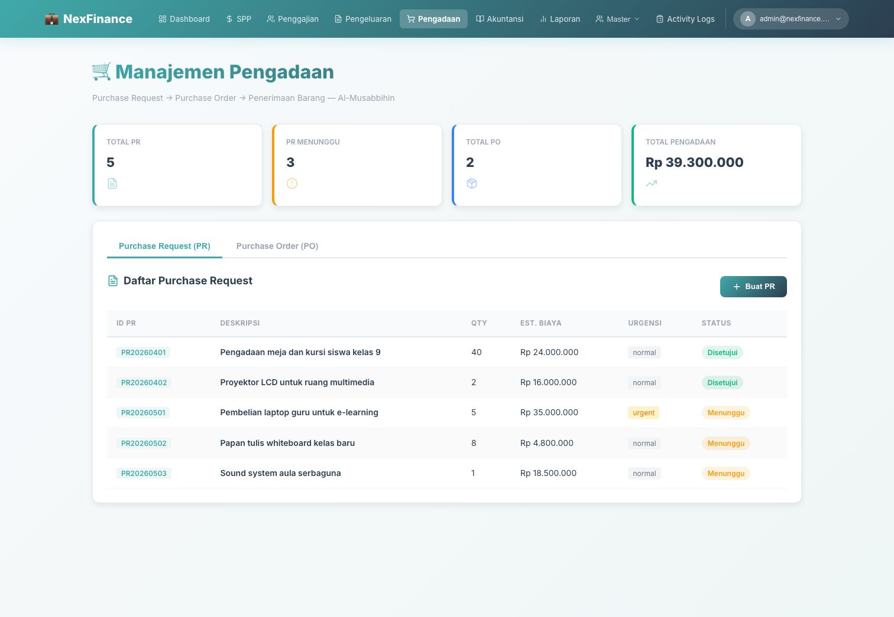

---

## 8. Modul Akuntansi

**URL:** `https://nexfinance.nexoratech.co/accounting`  
**Fungsi utama:** Pengelolaan jurnal dan chart of accounts.

**Yang bisa dilakukan:**
1. Melihat daftar akun (COA).
2. Menambah jurnal.
3. Meninjau ringkasan laporan akuntansi.

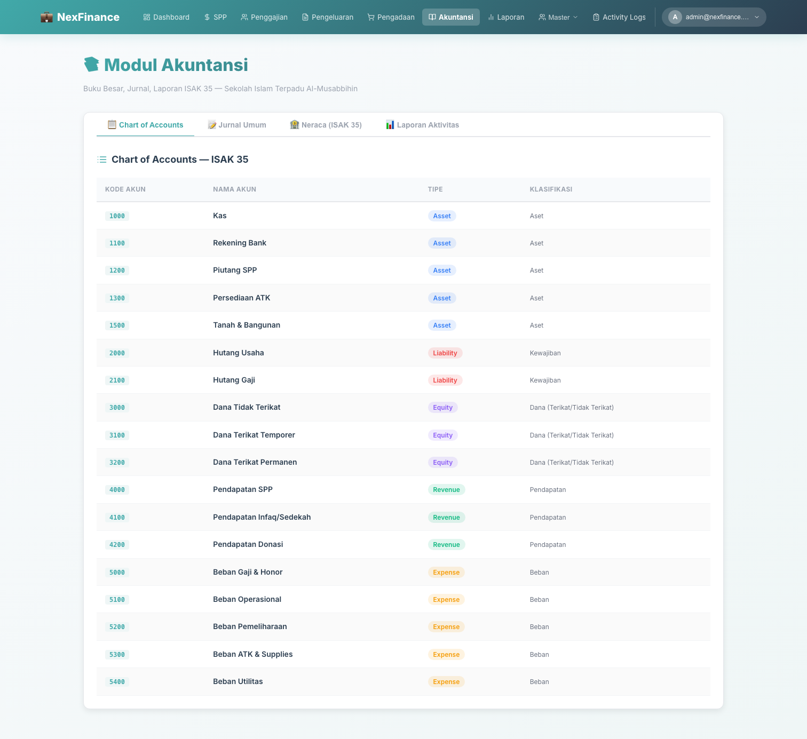

---

## 9. Modul Laporan

**URL:** `https://nexfinance.nexoratech.co/reports`  
**Fungsi utama:** Rekap laporan keuangan lintas modul.

**Yang bisa dilakukan:**
1. Melihat ringkasan performa.
2. Membandingkan data antar periode.
3. Menyiapkan data untuk monitoring manajemen.

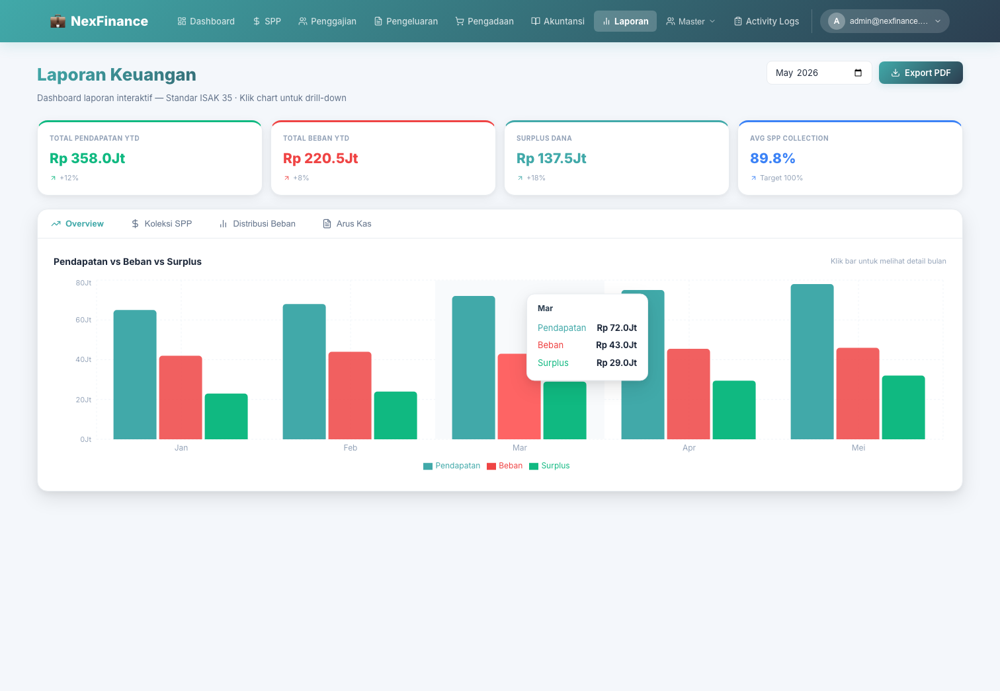

---

## 10. Master Data

### 10.1 Master Siswa
**URL:** `https://nexfinance.nexoratech.co/master/students`

1. Tambah/edit/hapus data siswa.
2. Gunakan pencarian untuk data cepat.
3. Pastikan data siswa aktif sesuai kondisi aktual.

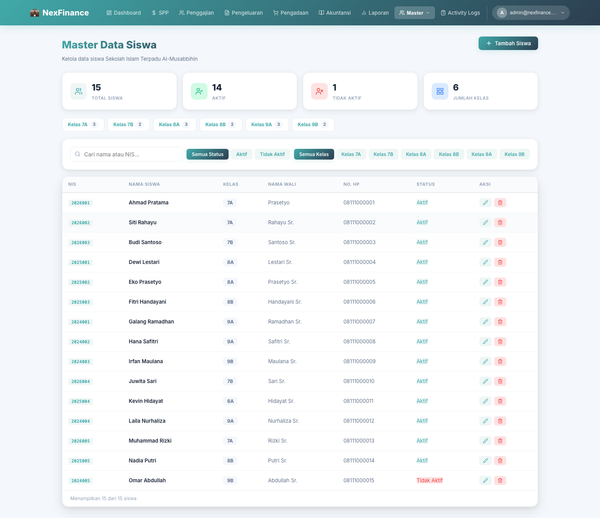

### 10.2 Master Karyawan
**URL:** `https://nexfinance.nexoratech.co/master/employees`

1. Tambah/edit data karyawan.
2. Kelola jabatan dan status karyawan.
3. Pastikan sinkron dengan kebutuhan payroll.

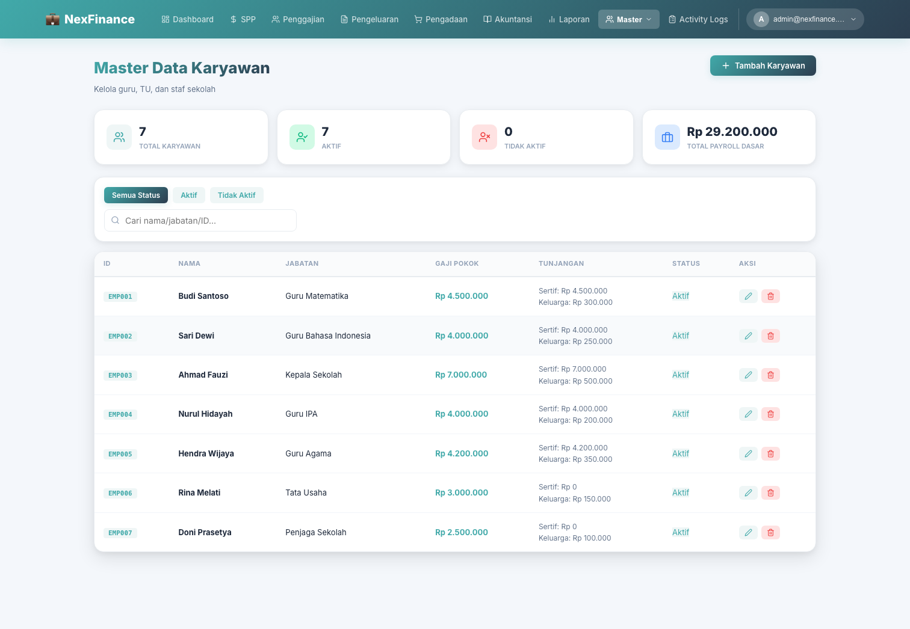

### 10.3 Master Hak Akses Role
**URL:** `https://nexfinance.nexoratech.co/master/access`

1. Super Admin dapat mengubah role user.
2. Super Admin dapat edit matriks akses modul per role.
3. Simpan perubahan dan lakukan review akses berkala.

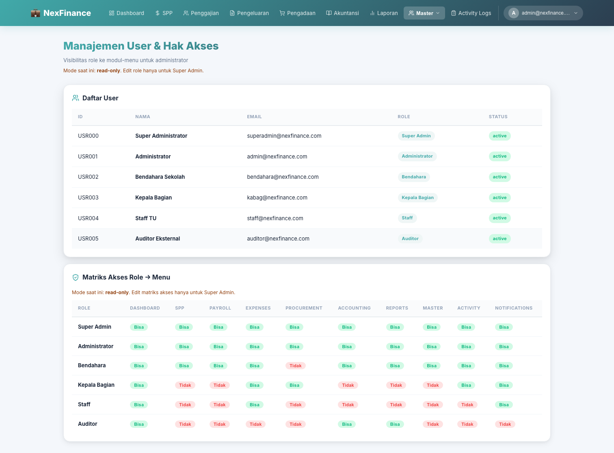

---

## 11. Activity Logs

**URL:** `https://nexfinance.nexoratech.co/activity-logs`  
**Fungsi utama:** Audit trail semua aktivitas penting pengguna.

**Yang bisa dilakukan:**
1. Filter log berdasarkan modul/aksi.
2. Cari aktivitas spesifik.
3. Pantau kepatuhan proses operasional.

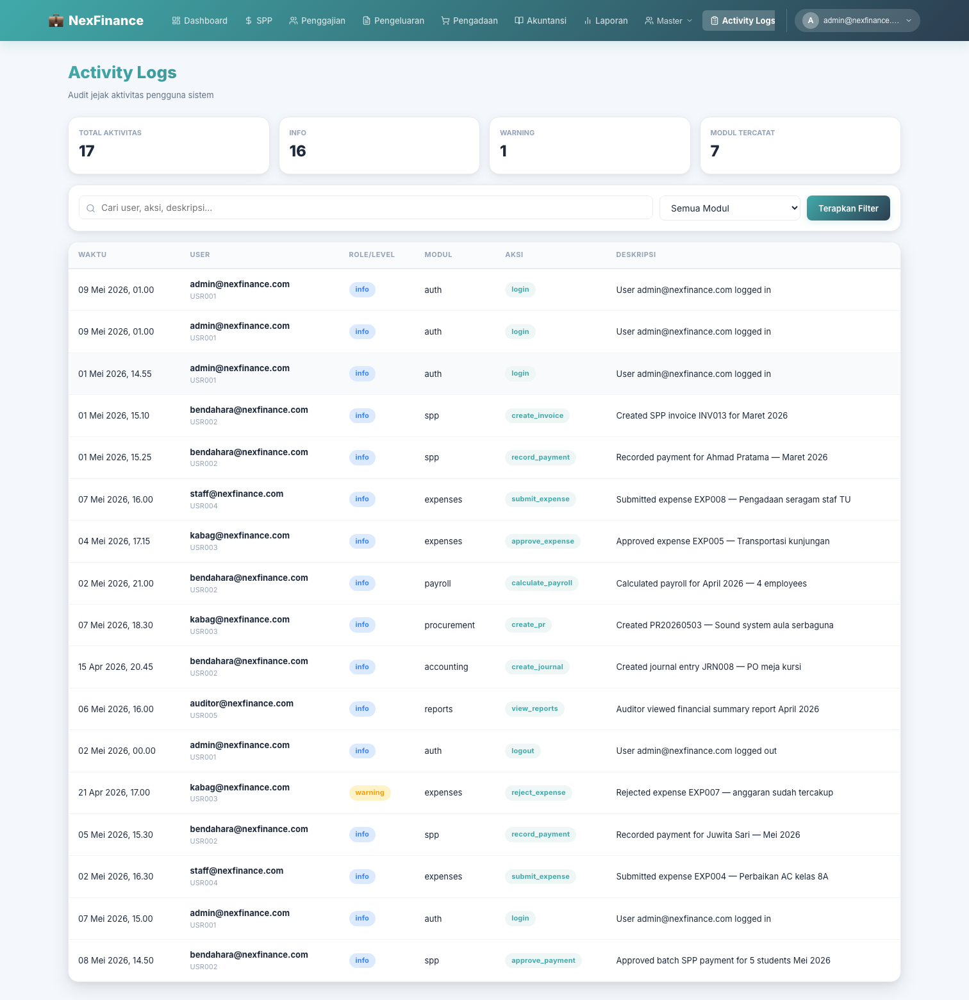

---

## 12. Notifikasi (Email & WhatsApp)

**URL:** `https://nexfinance.nexoratech.co/notifications`  
**Fungsi utama:** Pengiriman notifikasi manual/otomatis via Email & WhatsApp.

**Yang bisa dilakukan:**
1. Cek status integrasi channel.
2. Kirim notifikasi ke email/nomor WA.
3. Gunakan template pesan operasional agar konsisten.

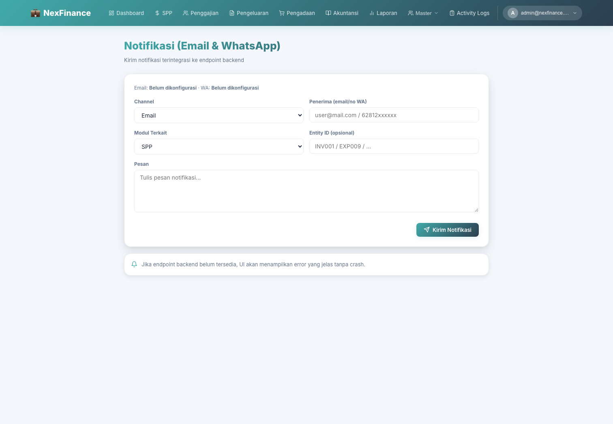

---

## 13. Panduan Navigasi Cepat

1. Menu utama ada di top navbar (desktop) atau burger menu (mobile).
2. Klik **Master** untuk membuka sub-menu Master Siswa, Karyawan, dan Hak Akses Role.
3. Klik avatar user kanan atas untuk membuka opsi **Keluar**.

---

## 14. Best Practice Operasional

1. Pastikan master data siswa dan karyawan selalu diperbarui.
2. Gunakan approval flow sesuai role untuk pengeluaran/pengadaan.
3. Audit Activity Logs setiap hari untuk memantau aktivitas kritikal.
4. Gunakan notifikasi Email/WA untuk komunikasi transaksi penting.
5. Lakukan pengecekan Dashboard di awal hari untuk monitoring cepat.

---

## 15. Catatan Penting

- Manual ini fokus untuk pengguna operasional, bukan konfigurasi teknis server.
- Untuk troubleshooting teknis/integrasi API, gunakan dokumen technical guide terpisah.
